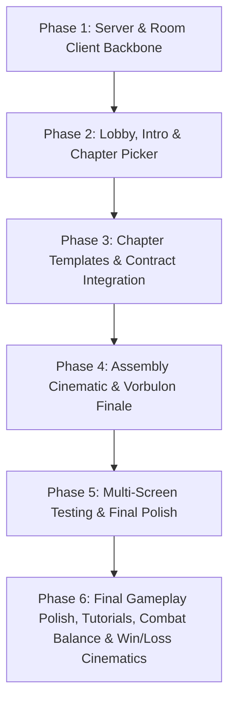

# Project Roadmap: The Legendary Sandwich From Hell

## Milestones & Phases

---

### Phase 1: Core Architecture, Authoritative Server & Room Client
**Goal:** Establish the `sandwich-hell` project directory, dependencies, Node.js + Express + Socket.IO server with in-memory room management, and the `room-client.js` connector.
- [x] Initialize `sandwich-hell/package.json` with `express` and `socket.io`.
- [x] Implement `sandwich-hell/server.js` with authoritative room state machine (`lobby`, `intro`, `picking`, `playing`, `finale`, `ending`).
- [x] Implement player management: 6-character room codes, player joining, host privileges, disconnect/reconnect handling.
- [x] Implement chapter locking mechanism: first-come first-served atomic claiming.
- [x] Implement `sandwich-hell/public/shared/room-client.js` with storage persistence and `Room.complete(...)` API.

---

### Phase 2: Lobby, Synchronized Intro & Real-Time Chapter Picker
**Goal:** Create a polished pre-game experience orchestrating all 4 monitors before gameplay.
- [x] Implement `public/lobby/index.html` with Create/Join room, code copy, and live player roster.
- [x] Implement synchronized intro cinematic screen with browser autoplay fallback.
- [x] Implement `public/pick/index.html` featuring interactive cards for Hell, Alien, Ocean, and Market.
- [x] Real-time card locking visual effects and automatic monitor redirection to claimed chapter URLs.

---

### Phase 3: Drop-in Chapter Templates & Provided Level Integration
**Goal:** Integrate the 4 complete level challenges from `C:\Users\ARNAV\SANDWICH GAME\LEVELS` into the game, preserving their exact puzzles, code editors, and test cases while binding them to the 4-monitor room engine.
- [x] Implement `public/hell/index.html` (Infernal Cheese): 10 coding scrolls in C, C++, Java with gutter, diagnostics, and test cases from `Hell-Cheese.html`.
- [x] Implement `public/alien/index.html` (Cosmic Vegetables): 12 vegetable challenges with in-browser C/C++/Java AST interpreter from `Vegetable-planet.html`.
- [x] Implement `public/ocean/index.html` (Abyssal Sauce): 10 switch-case potion trials with in-browser AST linter & grader from `Sauce-Ocean.html`.
- [x] Implement `public/market/index.html` (Eldritch Bread): 10 queue/recipe problems with judge API integration from `bread-marketplace/public/index.html`.
- [x] Integrate server-side `/api/judge` in `sandwich-hell/server.js` with hybrid compilation and simulation fallback.
- [x] Verify multiplayer completion synchronization: all 4 levels transmit `Room.complete(...)` and transition to `/finale`.

---

### Phase 4: Sandwich Assembly Cinematic & Leader Boss Battle
**Goal:** Deliver the dramatic waiting gate, sandwich assembly and Vorbulon video placeholders, leader-exclusive rapid-fire 10s C debugging boss battle, teammate spectator screen, and victory/defeat endings.
- [x] Implement `public/finale/index.html` with 4-ingredient Gathering Gate and video placeholders (Assembly & Vorbulon appearance).
- [x] Create 15-question dataset of rapid-fire corrupted C programs (`public/finale/boss-c-questions.js`) with easy syntax/logic bugs.
- [x] Implement Leader screen switch for Boss Battle: 10s countdown timer per question, code editor, and immediate patch feedback.
- [x] Implement Teammate static screen: `"You have successfully helped to find ingredients"` with real-time spectator HP bars.
- [x] Implement real-time combat synchronization in `server.js`: +20% boss damage on correct patch, -20% leader damage on timeout/error.
- [x] Implement dual endings: Victory (sandwich eaten by Leader, team stats) vs Defeat (sandwich destroyed, retry).

---

### Phase 5: Multi-Screen Playtesting, LAN Setup & Final Polish
**Goal:** Validate complete 4-player flow across 4 simultaneous browser tabs and multi-device LAN testing.
- [x] Conduct end-to-end 4-tab simulation of the complete game cycle.
- [x] Validate refresh / disconnect recovery at each phase of the game.
- [x] Verify LAN binding (`0.0.0.0:3000`) and print helpful local network connection instructions for multi-computer play.
- [x] Fine-tune UI styling, animations, contrast, and responsive layout across monitor resolutions.

---

### Phase 6: Final Gameplay Polish, Tutorials, Combat Balance & Win/Loss Cinematics
**Goal:** Harden the game for multi-PC lab deployment via forwarded ports, guarantee room isolation across concurrent teams, strip all dev cheats/shortcuts, verify all 42 puzzles and 6-solve quotas, balance Boss Battle to a 12s timer / 15% damage, and validate end-to-end simulation with win/loss cinematics.
- [x] Ensure 0.0.0.0 binding, origin-relative client sockets, CORS, and reverse proxy trust for lab port forwarding.
- [x] Verify guest PC room joining using only room codes and concurrent multi-room state isolation.
- [x] Remove all dev cheat buttons (Instant Win, Instant Lose, Bypass Ingredients, Win All) across all levels and Boss arena.
- [x] Comprehensive test suite for all 42 puzzles (Hell: 10, Alien: 12, Ocean: 10, Market: 10), 6-solve quotas, and skip navigation.
- [x] Balance Boss Battle to 12-second timer per question and 15% damage per strike/miss across 20 corrupted C questions.
- [x] Full end-to-end multi-room simulation: Lobby -> Intro -> Picker -> Chapters -> Cutscene -> Boss Battle -> WIN.mp4/LOSE.mp4 -> Stats -> Return to Main Page.

