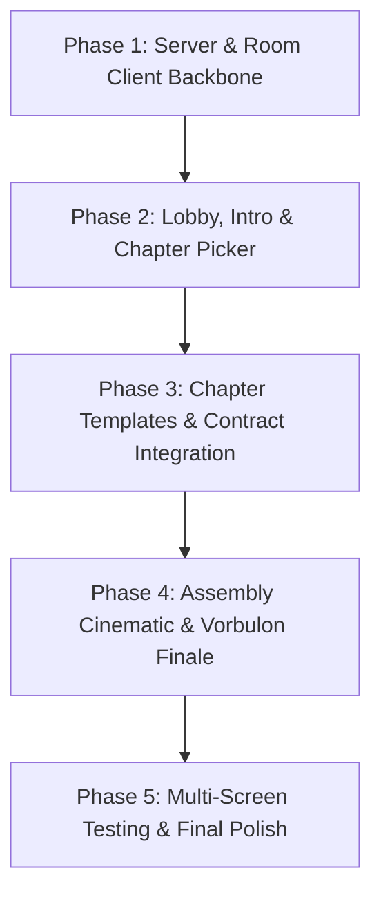

# Project Roadmap: The Legendary Sandwich From Hell

## Milestones & Phases

---

### Phase 1: Core Architecture, Authoritative Server & Room Client
**Goal:** Establish the `sandwich-hell` project directory, dependencies, Node.js + Express + Socket.IO server with in-memory room management, and the `room-client.js` connector.
- [x] Initialize `sandwich-hell/package.json` with `express` and `socket.io`.
- [x] Implement `sandwich-hell/server.js` with authoritative room state machine (`lobby`, `intro`, `picking`, `playing`, `finale`, `ending`).
- [x] Implement player management: 6-character room codes, player joining, host privileges, disconnect/reconnect handling.
- [x] Implement chapter locking mechanism: first-come first-served atomic claiming.
- [x] Implement `sandwich-hell/public/shared/room-client.js` with storage persistence and `Room.complete(...)` API.

---

### Phase 2: Lobby, Synchronized Intro & Real-Time Chapter Picker
**Goal:** Create a polished pre-game experience orchestrating all 4 monitors before gameplay.
- [ ] Implement `public/lobby/index.html` with Create/Join room, code copy, and live player roster.
- [ ] Implement synchronized intro cinematic screen with browser autoplay fallback.
- [ ] Implement `public/pick/index.html` featuring interactive cards for Hell, Alien, Ocean, and Market.
- [ ] Real-time card locking visual effects and automatic monitor redirection to claimed chapter URLs.

---

### Phase 3: Drop-in Chapter Templates & Teammate Integration
**Goal:** Provide ready-to-drop scaffolds for teammates' chapter pages with verified communication back to the server.
- [ ] Implement `public/hell/index.html` (Cheese / Boolean Logic) with demo puzzle trigger.
- [ ] Implement `public/alien/index.html` (Vegetables / Loops) with demo puzzle trigger.
- [ ] Implement `public/ocean/index.html` (Sauce / Functions) with demo puzzle trigger.
- [ ] Implement `public/market/index.html` (Bread / Dictionaries) with demo puzzle trigger.
- [ ] Integrate consolidated helper API routes (e.g. Market judge) directly into `server.js`.
- [ ] Document drop-in instructions for teammates in each template.

---

### Phase 4: Sandwich Assembly Cinematic & Vorbulon Boss Finale
**Goal:** Deliver the dramatic waiting gate, sandwich assembly animation, twist reveal of Vorbulon, and cooperative 4-player Python debugging fight.
- [ ] Implement `public/finale/index.html` with 4-ingredient waiting gate HUD.
- [ ] Create CSS/JS sandwich assembly animation sequence depicting the cursed ingredients fusing together.
- [ ] Implement the cosmic horror twist reveal of *Vorbulon, the Hungry Between Stars*.
- [ ] Implement Pyodide Web Worker runner with timeout watchdog (prevents infinite loop crashes).
- [ ] Design and implement 4 specialized corrupted Python functions (1 per player) with visible and hidden tests.
- [ ] Implement real-time boss health / hunger bar synchronizing player patch successes via Socket.IO.
- [ ] Implement victory ending sequence and credits.

---

### Phase 5: Multi-Screen Playtesting, LAN Setup & Final Polish
**Goal:** Validate complete 4-player flow across 4 simultaneous browser tabs and multi-device LAN testing.
- [ ] Conduct end-to-end 4-tab simulation of the complete game cycle.
- [ ] Validate refresh / disconnect recovery at each phase of the game.
- [ ] Verify LAN binding (`0.0.0.0:3000`) and print helpful local network connection instructions for multi-computer play.
- [ ] Fine-tune UI styling, animations, contrast, and responsive layout across monitor resolutions.
